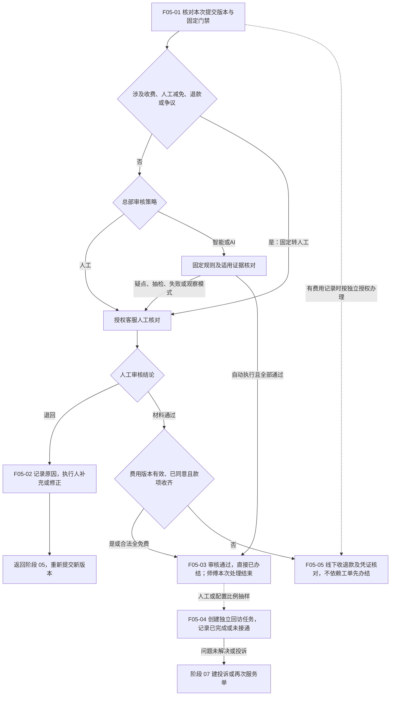

# 06 · 完工审核与抽样回访

更新日期：2026-10-14 · v0.6（统一首期收费门禁与独立抽样回访）· 节点前缀 F05

[总览](00-售后全流程总览.md) · [上一阶段：履约提交](05-服务履约与完工提交.md) · [异常与再次服务](07-异常取消与再次服务.md)

## 范围与依据

- **输入：**完工提交版本、服务结果、适用客户确认及配件等证据。
- **输出：**审核结论、办结记录、可选的抽样回访结果和可追溯服务历史。
- **责任端：**Web 授权审核／客服人员、消费者小程序评价、服务人员端仅在审核退回时补充材料；策略由总部维护，人工处理限已获审核授权客服岗；服务站仅配合补资料。
- **依据：**[后台需求](../01-功能需求/04-统一管理后台需求.md) CS-009／010／014、STA-005；[服务人员需求](../01-功能需求/07-服务人员小程序需求.md) WAPP-011／012；[审核首版 Spec](../specs/04-服务履约配件与费用/2026-09-10-派单异常与完工审核全栈首版.md)。

完整状态值、条件和责任见[服务工单状态机](../02-技术设计/03-业务契约/04-服务工单状态机与单据状态.md)。

## 流程图

人工／智能／AI审核及通过直接办结是现有契约。首期线下收费已接入后端固定门禁：收费或财务风险转原授权人工审核；未收齐不得办结，不开放后付例外。全免费模式继续采用原审核策略。源码与本机研发验证不代表目标环境发布或业务验收，见[首期实施与边界](../specs/04-服务履约配件与费用/2026-10-03-服务工单线下收费开发计划.md#offline-fees-delivery)。

## 节点与交接

| 节点 | 执行责任与动作 | 输出与限制 |
| --- | --- | --- |
| F05-01 | 授权客服或系统按策略审核结果、产品、材料及适用配件记录 | 审核关联具体提交版本；不能改写执行人原始记录 |
| F05-02 | 审核人说明问题，执行人补充修正 | 保留原材料和退回原因，新材料重新提交；不直接覆盖被退回版本 |
| F05-03 | 后端保存通过结论和办结历史 | 直接进入已办结，无需师傅再次交单；抽样回访与结算分别处理 |
| F05-04 | 自动通过按配置比例抽样，或有权限客服人工抽样并办理 | 单工单至多一条回访任务；已完成需记录满意度与内容，未接通不伪造评价；不改变工单状态 |
| F05-05 | 师傅按权限登记本单线下收款；获权后台岗位处理纠错／退款／争议并核对凭证 | 未收／部分收款如实记录，完工材料仍可保存；未收齐不得审核办结，不开放后付例外；不得重复扣库或收款，见[费用专题](08-费用确认与线下收款.md) |

## 与费用专题的交接（首期已确认规则）

详见[费用确认与线下收款](08-费用确认与线下收款.md)。收费单关联报价及最终费用版本，由授权人工核对收费依据、客户同意、耗用及异常；当前智能／AI审核没有财务核验能力，首期不自动通过涉及收费、人工减免、退款或费用争议的单据。全免费模式不增加财务审批步骤，免费但使用配件的单据仍遵守现有配件转人工门禁。

费用记录与工单状态分别持有：审核通过仍直接 `CLOSED`，但当前费用版本未收齐时禁止审核办结，不开放后付例外。未收或部分收款事实和完工材料可以保存，不能伪造已收齐。收费确认缺失或有争议进入人工处理，不得自动办结。消费者现有三阶段进度保留，费用情况在详情独立展示。

## 未定档部分须保留在图上

- **Q-004：**默认二次交单已取消，审核通过直接办结；抽样回访不阻塞办结。剩余为审核岗位、旧待交单数据核对及未来确有必要的纸质原件移交，不再作为全部工单的必经节点。
- **Q-006 及回访规则：**自动审核抽检和办结后回访抽样已支持总部配置（见[审核契约](../specs/04-服务履约配件与费用/2026-10-01-完工智能与AI审核.md)）；多级审核、联系次数、消费者自发评价与回访评价合并策略待确认；未接通可结束本次抽样任务，不阻塞已办结工单。
- **Q-007：**2026-10-03 已明确本次首期收费方案仅考虑线下收费；默认全免费兼容、开关、报价／口头同意、独立收退款权限、严格配件零售价及未收齐不得办结均已确认并完成首期源码接入；正式收费政策维护、微信／真机和业务验收仍待完成，线上支付及服务商结算不纳入本次。不把费用处理画成全部工单必经末站。
- **终态口径：**审核通过形成正常终态 `CLOSED`（已办结），取消形成 `CANCELLED`；后续问题建立投诉或再次服务单，见阶段 07。

设计检查包括一次通过、退回重提、审核通过后无二次提交、回访未接通、未抽中、投诉未解决和正常办结。端到端业务验收仍需真实岗位与实际订单验证。
