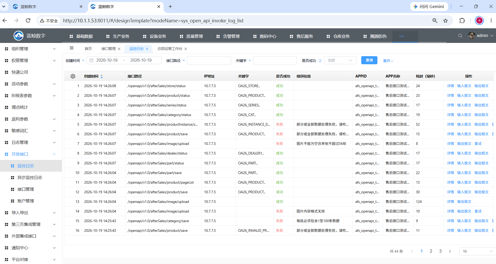

# 售后开放接口测试与部署记录

日期：2026-10-19。环境：[10.1.1.53:8011](http://10.1.1.53:8011/)，实际运行库 `mysql84 / gaia_wh_init_wzy`。本记录为研发验证，业务验收另行确认。

## 发布结果

完整后端WAR及主站、售后子站发布编号 `20261019141645-164747af`，14:24:12完成，运行PID582433。使用正式部署的原始 support.py / remote.sh，Windows仅适配物理路径与调用入口。备份位置 `/yundata/saas_test/backups/20261019141645-164747af`。保留5份内嵌运行配置与外部配置；WAR SHA256为 `191e09600b44f827865159f092fd31576558a658a0f62e48538544a295cd1283`。

售后后端提交 `c631702`，前端 `603a3882`，宿主文档 `e549a33` 已推送。前后端、小程序和知识库先拉取合并；应交付的历史知识改动纳入本次提交，私有配置与运行产物排除。

## 核验结果

| 项目 | 结果 |
| --- | --- |
| 后端构建 | core及API全量通过，API538项；最终9项定向回归通过并重新装配宿主 |
| Web检查 | 823项测试、类型及国际化检查通过；3语言/35模块/4775键 |
| Web产物 | 主站与售后子站构建成功；301项JS/CSS检查及22个入口资源引用通过 |
| 发布访问 | 31项静态资源摘要通过，3项公开响应成功，3项匿名请求拒绝且不返回业务数据 |
| 八类主数据 | 32项真实冒烟全部符合预期，覆盖新增/更新/查询、部分失败、字段保留、版本冲突、关联错误与批量边界 |
| 图片及状态 | 16项补充检查符合预期；真实PNG上传/商品及配件引用、假图片/超5MB/超10图拒绝、六类启停、实物不可变关系与令牌拒绝 |
| 授权 | 临时撤销测试账号单接口授权后返回40009，finally恢复原授权并回读 |
| 监控 | 本轮46个业务响应requestId全部匹配原平台日志；覆盖23个接口，漏记0；两项令牌拒绝发生在业务入口前 |
| 数据 | OA26_模拟主档重复推送后编号均唯一；商品未上架且小程序不可见 |

开放账号 `afs_openapi_test_20261019` 已启用并按现有账号机制配置，初始化授予当时713个开放接口权限；密钥从账号管理查看，不进入交付文件。分类“售后服务”、23项接口及日志配置已落库，初始化及回退SQL见本目录sql。

初轮两次分类保存遇到平台既有日志Redis序列落后于表内主键，日志写入报主键2/3冲突；业务保存成功，原始错误和缺失requestId证据保留，未补造历史日志。序列自然越过既有主键后重跑完整32+16项检查，本轮46/46日志匹配。当前累计90条售后调用记录；数量会随后续测试增加。未修改平台公共序列或扩大售后序列校准范围。

可在[开放接口→监控日志](http://10.1.1.53:8011/#/designTemplate?modeName=sys_open_api_invoke_log_list)按路径 `/openapi/v1.0/afterSales`、测试APPID和日期查询。示例成功requestId `a55061ff-bcab-4357-aea7-7db2852adae0`；预期校验失败requestId `381ade50-3579-4fca-9edd-d83a6415cb93`。失败用例在页面显示红色“失败”是预期结果。

下图由用户在Chrome提供，展示初轮44条日志的真实页面；自动浏览器连接超时，未宣称由自动化完成页面交互。后续完整复测的90条记录已独立数据库回读。

## 复现与留痕

按[接口文档](接口文档.md)获取测试账号Token；模拟数据在 `模拟数据/`，运行 `run-smoke.mjs --run`，密钥仅通过环境变量传入，建议输出到已忽略目录。SQL在 `sql/`，重复执行不重置已有密钥；回退停用本批账号与接口，不删除业务数据和日志。

原始构建日志、响应、请求ID逐条匹配、权限恢复回执及发布清单位于本机 `.local/verification-artifacts/20261019-openapi/`，含私有凭据的文件不提交。消费者和服务人员小程序已同步最新远端并完成检查。消费者上传因未配置对应AppID的WECHAT_CI_PRIVATE_KEY_PATH而未启动；服务人员按现有上传实现重新构建后，微信CI工具报缺少normalize-url依赖，未取得成功回执，未自动重试或回退Web发布。两端开发版均不能标记上传成功。
