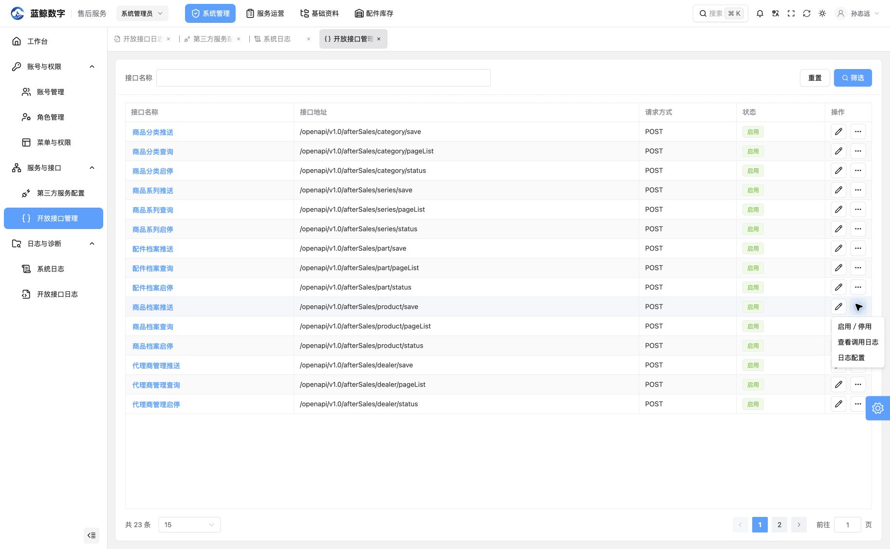
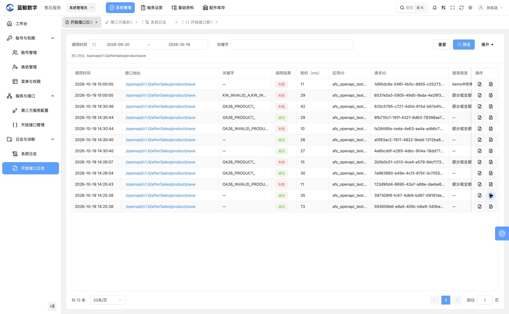

# 售后接口管理与监控日志子系统接入

- 编号：REQ-20261019-AFS-OPENAPI-CONSOLE。
- 来源：用户要求在子系统系统管理中增加售后接口管理、接口监控日志，只展示售后服务相关内容，复用平台后端与数据，同步菜单及权限、完成验证，先不提交。
- 状态：前端已本地提交 `ef58fabb`，项目版本v0.24.17；测试库菜单及权限已同步；已推送并随共享完整发布 `20261019180142-7e462e40` 生效，Web／后端COMPLETE、双端UPLOADED，不增加业务验收计数。
- 前置契约：[售后基础数据开放接口](2026-10-19-售后基础数据开放接口.md)。

## 页面与操作

管理员视角的“系统管理 → 服务与接口 → 开放接口管理”和“系统管理 → 日志与诊断 → 开放接口日志”为两个独立页面，复用 `FaPageMain layout="list"`、`EsSearch`、`EsTable`、`useListPage`、`useCrudDialog`、`EsFormDialog` 和 `EsDetailDialog`。中、英、日三语及本地图标同步；四个业务视角保持。

| 功能 | 注册编码／路径 | 当前能力 |
| --- | --- | --- |
| 开放接口管理 | `afsOpenApi`／`afterSales/system/openApi` | 名称筛选、服务端分页、详情、接口名称及请求／响应示例编辑、启停、输入／输出日志记录配置 |
| 开放接口日志 | `afsOpenApiMonitor`／`afterSales/system/openApiMonitor` | 默认近30天、关键字、结果、完整接口地址、应用ID筛选，服务端分页、调用摘要与独立授权的输入／输出查看 |

注册目录为 `afsSystem`／`afterSales/system`，3个新增模块ID为 `2026101902001`～`2026101902003`。接口及日志不建立副本：主系统与子系统调用相同平台管理API，操作后重新查询看到同一份数据。原平台 `sys_open_api_list` 与 `sys_open_api_invoke_log_list` 菜单保留。

接口地址、HTTP方式、分类、认证方式及其他传输配置保持原详情，不提供新增／删除系统实现的接口或任意移动分类。编辑按平台全量DTO更新规则保留不可编辑元数据，提交只传白名单；提交前重新读取详情并拒绝已观察到的并发变化。启停先确认影响，再读取当前状态，避免按旧列表状态重复翻转；未确认写入结果不自动重试。原平台没有原子乐观锁参数，读取与写入之间的竞争窗口继续存在。

日志配置读取当前23个v1.0接口初始化SQL登记的同ID配置，并核对返回的 `apiId`；不假设其他平台接口也满足同ID关系，不回退到无范围的全量配置列表。关键字保持现有售后业务编号提取规则，只调整输入／输出记录开关。

日志报文兼容原平台 `/api/sys/commontools/downloadFileById?id=...` 存储引用：沿现有同源请求封装携带当前认证读取文本，包含宿主 `/api` 上下文、取消与过期响应隔离；不将用户令牌发送到任意日志URL。原始JSON作为文本展示，不执行HTML；普通HTTP(S)文件地址仅提供显式打开入口。弹窗关闭／页面离开／授权失效后清理旧响应及报文；文件加载失败可重试。

不增加日志重试、历史回填、开放账号或密钥管理。重试会再次执行业务请求，兼容性及授权另行确认；本轮不修改公共模块、售后后端或聚合宿主源码。

## 范围与权限

- 接口列表固定 `path=/openapi/v1.0/afterSales/`，名称条件和分页交给现有 `/api/sysOpenApi/list`；详情、操作前校验返回ID及完整售后路径。
- 日志列表固定 `clazzName=com.ehsure.gaia.afterSales.openapi.AfterSalesOpenApi`，配合原平台支持的关键字、结果、日期、应用ID和精确请求地址查询；不拉取全平台记录再按当前页过滤，不伪造总数。
- 新功能只在具有真实售后管理员资格与对应稳定菜单授权时可达。页面读取本模块真实按钮清单；查询权限缺失不发列表请求，编辑、启停、配置、输入和输出分别控制。权限初始化失败可通过重新筛选重试，业务列表失败沿通用错误反馈恢复。
- 以上是页面范围约束。平台管理API仍按原平台权限运行，获得该API的账号可直接请求平台其他记录；本轮不声称实现服务端售后行级隔离。平台日志列表原本包含报文，子系统列表模型丢弃这些字段，只有取得对应查看权限后才打开报文；这也不等于平台按字段隔离。

| 新模块 | 操作编码 | 精确API |
| --- | --- | --- |
| `afsOpenApi` | `read` | GET `/api/sysOpenApi/list`、`/detail` |
| `afsOpenApi` | `edit` | PUT `/api/sysOpenApi/edit` |
| `afsOpenApi` | `status` | GET `/api/sysOpenApi/enable` |
| `afsOpenApi` | `config` | GET `/api/sysOpenApiLogConfig/detail`、PUT `/edit` |
| `afsOpenApiMonitor` | `read` | GET `/api/sysOpenApiInvokeLog/list` |
| `afsOpenApiMonitor` | `input`／`output` | GET `/api/sysOpenApiInvokeLog/detail`；原平台共用详情接口 |

操作ID为 `2026101902101`～`2026101902107`。既有角色1、2及售后系统管理员70在已有 `afsNavigationAdministrator` 授权前提下增加9条菜单、21条操作绑定；其他正式岗位、原账号资料及既有绑定保持。角色可授权目录自动包含售后树内新节点，管理展示按同一管理员清单投影归入“服务与接口”“日志与诊断”；原始注册目录与角色绑定保持。

## 测试库配置与回退

目标通过独立连接确认 `DATABASE()=gaia_wh_init_wzy`、`@@hostname=mysql84`，本机后端与共享应用使用该测试库。配置同步不代表共享前端已发布。

- [售后菜单及授权SQL](sql/20261019-售后接口管理与监控菜单.sql)：新增3个模块、7项操作及上述绑定；新目录排序13与生成器当前清单一致；执行前核对ID／code冲突，事务内写入，并用原有各表行数与摘要确认未修改无关配置。
- [原平台权限映射兼容SQL](sql/20261019-售后接口管理平台权限兼容.sql)：平台对已登记API统一鉴权，因此同步给原接口管理／监控菜单及原编辑、启停、配置、输入／输出按钮补同一精确映射，账号API授权按钮保留接口目录读取能力。不新增原平台角色授权，不覆盖原 `api_list`；通用按钮查询API不新增限制。
- 初次新增40条记录；兼容处理涉及13次行更新（含同一行分次追加及两个新模块移除通用API登记）。执行前的摘要、原 `api_list`、回退SQL与结果仅存忽略目录 `.local/verification-artifacts/20261019-openapi-system-pages/`。
- 回退先恢复平台映射原值，再删除本批角色操作／菜单关系、操作和模块；不删除开放接口、调用日志或售后业务数据。回退前复核本批节点是否已被后续角色引用。

## 系统管理导航整理（2026-10-19 续轮）

用户确认按前次审查方案实施。当前结构如下；分组是前端展示投影，不是新增 Gaia 注册节点。

```text
系统管理
├─ 工作台
├─ 账号与权限
│  ├─ 账号管理
│  ├─ 角色管理
│  └─ 菜单与权限
├─ 服务与接口
│  ├─ 第三方服务配置
│  └─ 开放接口管理
└─ 日志与诊断
   ├─ 系统日志
   └─ 开放接口日志
```

- 用户管理改为账号管理；外部服务配置改为第三方服务配置；售后接口管理改为开放接口管理；日志查询改为系统日志；接口监控日志改为开放接口日志。页面标题、导航搜索、管理员首页快捷入口、中英日翻译同步。角色管理、菜单与权限、系统管理和工作台保留名称。
- 三个分组分别使用 `lucide:key-round`、`lucide:network`、`lucide:folder-search`；第三方服务保留插头，开放接口使用 `lucide:braces`，系统日志使用 `lucide:scroll-text`，开放接口日志使用 `lucide:file-code-2`。本地图标集合及管理树映射同步，系统管理模块内图标不重复。
- 系统日志继续查询系统请求、业务事件及审计摘要；开放接口日志继续查询外部系统调用售后开放接口的记录，支持原独立报文授权。两个页面及其后端数据、权限不合并。
- 开放接口每行“更多操作 → 查看调用日志”携带精确 `requestUrl` 跳转；先核对目标 `afsOpenApiMonitor.read`，无目标菜单／读取权限时不显示且事件处理再次拒绝。源接口读取权不隐含目标日志读取权，不新增按钮授权或后端接口。
- 日志落地保留近30天默认范围、回到第1页，仅请求该接口；分页沿用已应用条件。重复从其他接口进入时更新筛选，同一日志页签复用；重置可清除关联条件恢复常规查询。非法、非售后或多值路由参数拒绝，不退回无条件全量查询。请求取消与过期响应隔离继续由现有 `useListPage` 处理。
- Gaia 仅按 code 原地更新三个售后专用菜单的 `name`／`icon`，见[本轮同步 SQL](sql/20261019-系统管理菜单名称与图标.sql)。已确认目标 `gaia_wh_init_wzy/mysql84`，执行前备份回退；不改变 ID、路径、父级、API 映射、操作及任何角色关系。共享 `sys_user_list`、`operation_log`／`login_log` 原名称保留，子系统本地投影为账号管理／系统日志，不修改主系统公共菜单。角色授权展示自动跟随管理员分组。

本轮原始检查、真实接口结果、配置备份与回退仅保存在 `.local/verification-artifacts/20261019-system-menu-adjust/`。本机研发验证结果见下；未提交、推送或发布共享前端，不增加业务验收计数。

## 研发验证

复用原有9010售后前端和8080聚合后端，无重启、无新增应用服务。以下验证均为研发检查，不代替业务验收。

- 子系统最终完整检查通过：lint、依赖、应用／测试类型、三语（36模块／4878词条）、841项回归全部通过；生产构建和308项JS／CSS产物体积检查通过。根仓菜单交付包11项测试通过，已生成当前交付包与只读预检SQL。
- 平台真实API完成8组操作检查：编辑保存与回读、启停与回读及恢复、日志配置与回读、23接口两页15+8、空查询、售后日志与输入／输出详情、失败筛选。验证选用商品分类查询接口，先备份，结束经API及独立数据库恢复原接口／日志配置。
- 最小只读测试身份完成7组权限检查：仅read操作、允许查询、编辑／配置／报文详情被原平台明确拒绝、撤权后真实快照无两个入口且两个列表API均拒绝。临时用户、角色及全部关系已清理，原两个正式账号和七个岗位保持。
- 通过身份API准备夹具时发现当前运行进程的原平台角色主键生成器返回1，与已有角色冲突，事务未留下新角色。本轮未调整共享序列或修改后端，改用明确独立ID的测试夹具完成权限验证后清理；不把既有角色新增故障记为本功能已修复。
- 本机Chrome真实售后管理员检查菜单、直接路由、23条接口列表、编辑弹窗不可变地址、日志配置两个原值开关、107条日志、关键字筛选10条及输出详情；原平台文件引用已实际解析为JSON业务失败报文。桌面日期范围和报文图标已复核，两张最终列表截图留存如下。
- 未新增主系统页面、iframe、多租户分发、共享应用发布或业务验收；不以数据库配置同步代替这些验证。

### 导航整理续轮验证

- 最终子系统完整检查与生产构建通过：847项回归、三语36模块／4880词条、308项JS／CSS产物检查；根仓菜单交付包11项测试通过，已重新生成交付包及只读预检SQL。
- 新增实际页面逻辑回归覆盖日志落地单次查询、分页保留精确接口、重复跳转更新接口并回到第1页、重置恢复常规查询、离开页面不查询、非法地址不降级全量请求，以及源读取权与目标日志读取权独立。菜单图标、页签身份、部分授权单项直达及角色勾选投影回归通过。
- 真实管理员接口确认三个售后菜单名称与角色可授权目录同步；接口操作仍为read／edit／status／config，日志仍为read／input／output。分类推送11条、商品推送12条日志分别按5条一页读取两页，均精确匹配目标接口。
- 独立临时只读身份初始可读两个页面；只移除目标日志菜单及read操作后，源接口管理菜单与列表仍允许，目标日志菜单消失，日志列表API被平台拒绝（原平台业务码500）。该身份和全部关系已在finally中清理，原账号保持；未通过旧测试账号推断本轮拒绝结果。
- 测试库三个专用菜单原地同步前后，所有其他模块、操作、角色菜单及角色按钮记录摘要一致；回退材料保存在忽略目录。共享主系统账号／日志菜单名称未改，后台业务实现未改。
- 本机Chrome复用9010及8080完成当前中文菜单、图标、接口行操作、分类与商品两次精确日志跳转、筛选条件反馈及重置；角色编辑器已只读展开确认三个新分组及独立开放接口节点，原93个页面／191个操作和另2项隐藏保留权限未改，退出未保存。最终界面证据已更新为本轮状态。未启动主系统或执行共享应用部署。

## 源码入口

- [平台请求适配](../../../frontend/gaia-ui/apps/after-sales/src/api/platformOpenApi/client.ts)
- [接口管理页面](../../../frontend/gaia-ui/apps/after-sales/src/views/system/openApi/index.vue)及[日志页面](../../../frontend/gaia-ui/apps/after-sales/src/views/system/openApiMonitor/index.vue)
- [菜单清单](../../../frontend/gaia-ui/apps/after-sales/src/features/navigation/manifest.json)及[范围与权限回归](../../../frontend/gaia-ui/apps/after-sales/tests/platform-open-api.test.ts)

## 最终界面证据

2026-10-19，本机Chrome、当前真实售后系统管理员、复用9010与8080，数据为原平台已有受控开放接口样本。仅保留两个页面的最终列表状态，截图不含令牌或密钥；原始日志、配置备份与中间材料不纳入Git。





## 提交、推送与共享发布

2026-10-19按用户授权，Web提交`ef58fabb`、文档`c19ffc57`已推送，项目版本v0.24.17。正式完整发布`20261019180142-7e462e40`已验证Web／后端COMPLETE、消费者与服务人员test开发版0.1.1均UPLOADED；共享真实菜单名称、稳定ID、权限目录、23接口和12条精确接口日志回读通过，匿名访问拒绝，3份关键页面资源摘要与本次构建一致。完整范围、回执、备份及待验边界归[部署台账](../03-开发管理/09-测试服务器部署.md#release-20261019-system-menu)。前文未提交／未发布为对应研发阶段事实，本节为当前交付状态；本次不增加业务验收。
